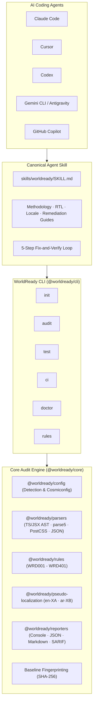

<div align="center">

# 🌐 WorldReady

### Internationalisation Engineering for AI Coding Agents
**Find it. Fix it. Prove it.**

[](https://github.com/songalobung/WorldReady/actions)
[](https://www.npmjs.com/package/@worldready/cli)
[](LICENSE)
[](https://nodejs.org)
[](CONTRIBUTING.md)

[English](README.md) | [简体中文](docs/README.zh-CN.md) | [العربية (RTL)](docs/README.ar.md) | [日本語](docs/README.ja.md) | [Español](docs/README.es.md) | [Français](docs/README.fr.md) | [Deutsch](docs/README.de.md)

<p align="center">
  <b>An open-source internationalisation (i18n) & RTL readiness auditor with executable proof for AI coding agents and production CI pipelines.</b>
</p>

</div>

---

## 📑 Table of Contents

- [The Core Proposition](#-the-core-proposition)
- [Why WorldReady? (Competitive Landscape)](#-why-worldready-competitive-landscape)
- [The Five Core Differentiators](#-the-five-core-differentiators)
- [System Architecture](#-system-architecture)
- [Quick Start](#-quick-start)
- [Rule Catalogue](#-rule-catalogue)
- [The 5-Step Fix-and-Verify Loop](#-the-5-step-fix-and-verify-loop)
- [Pseudo-Localization Engine](#-pseudo-localization-engine)
- [International SEO Auditing](#-international-seo-auditing)
- [CLI Reference](#-cli-reference)
- [Continuous Integration (CI) & SARIF](#-continuous-integration-ci--sarif)
- [Cross-Platform Agent Distribution](#-cross-platform-agent-distribution)
- [What We Deliberately Do Not Build](#-what-we-deliberately-do-not-build)
- [Quality Standards & Benchmark Corpus](#-quality-standards--benchmark-corpus)
- [Product Implementation Roadmap](#-product-implementation-roadmap)
- [Contributing](#-contributing)
- [License](#-license)

---

## 🎯 The Core Proposition

> **Give an AI coding agent a repository. WorldReady identifies internationalisation failures, explains their impact, proposes safe fixes, and verifies the result with executable tests.**

The differentiator is **proof, not advice**. 

An agent saying *"your Arabic layout looks fine"* is not enough. WorldReady produces reproducible checks, file-and-line evidence, AST-verified test results, and deterministic proof.

WorldReady targets cross-platform distribution from day one while maintaining **one canonical engine**: Claude Code, Codex, Cursor, Gemini CLI, and GitHub Copilot share the exact same rules and test logic.

---

## 🥊 Why WorldReady? (Competitive Landscape)

Existing i18n developer tooling falls into four distinct categories:

1. **Knowledge Skills**: LLM prompts explaining how i18n works (e.g. `i18nstack`).
2. **Translation Tools**: Extraction, glossary sync, and translation workflows (e.g. `Lingo.dev`, `Weblate`).
3. **Framework-Specific Automation**: AST transforms locked to a single library (e.g. `Globalyze`, `i18next-cli`).
4. **Isolated Linters**: Syntax-only translation file checkers (e.g. `Lingual i18n-check`).

### Competitive Comparison

| Project | Primary Focus | Where WorldReady Differs |
| :--- | :--- | :--- |
| **[i18n-agent/i18nstack](https://github.com/i18n-agent/i18nstack)** | Agent prompts & skill collection | WorldReady is an **executable deterministic engine**, not just prompts. |
| **[better-i18n/skills](https://github.com/better-i18n/skills)** | Platform-specific agent references | Framework-independent with zero vendor or platform lock-in. |
| **[Globalyze](https://github.com/bil0000/globalyze)** | React AST code transformations | Audits whole repositories across React, Next.js, HTML, CSS, and locale catalogs without altering architecture. |
| **[i18next-cli](https://github.com/i18next/i18next-cli)** | i18next-specific extraction & linting | Complements i18next with cross-framework readiness, RTL simulation, and bidi correctness. |
| **[Lingual i18n-check](https://github.com/lingualdev/i18n-check)** | Translation JSON/ICU file validation | Goes beyond translation files to inspect AST UI components, CSS logical properties, and formatting. |
| **[Lingo.dev](https://github.com/lingodotdev/lingo.dev)** | Translation workflows & LLM translation | WorldReady audits readiness and prevents regressions; it does not replace translators or translation management. |
| **[Weblate](https://github.com/WeblateOrg/weblate)** | Translation management platform | WorldReady does not manage translators; it provides local developer tooling and CI regression testing. |

**WorldReady owns the 5th category:** end-to-end internationalisation readiness auditing and regression testing across the entire application stack.

---

## 🌟 The Five Core Differentiators

### 1. Framework-Independent Auditing
Most tools are tied to a single library or runtime. WorldReady uses a common analysis core with AST-level parsers for **TypeScript/JavaScript (JSX/TSX)**, **HTML (parse5)**, **CSS (PostCSS)**, and **JSON/ICU locale catalogs**. The same audit runs seamlessly across Next.js, React, Vue, Svelte, or vanilla web stacks.

### 2. RTL and Bidirectional Correctness as First-Class Citizens
Direction is a property of the **script, not simply the language code** (e.g. Azerbaijani can be written in Latin, Cyrillic, or Arabic scripts, per W3C standards). WorldReady inspects:
- Missing or invalid document `dir` declarations.
- Physical CSS properties (`margin-left`, `padding-right`, `float: left`, `text-align: right`) that break layout mirroring, recommending CSS Logical Properties (`margin-inline-start`, etc.).
- Mixed Arabic/Hebrew and Latin text requiring bidirectional isolation (`<bdi>`, `dir="auto"`).
- Form inputs and controls lacking dynamic directional adaptation.

### 3. Real Locale Behaviour Testing
Backed by **Unicode CLDR (Common Locale Data Repository)** data:
- Date, time, and timezone formatters.
- Currency, percentage, and decimal separators.
- Locale-sensitive string collation and sorting (`Intl.Collator`).
- Cardinal and ordinal plural rule validation (e.g. Arabic's 6 plural forms vs English's 2).
- Language-specific text expansion factors and clipping checks.

### 4. Deterministic Fix-and-Verify Loop
```
Audit ➔ Explain ➔ Propose Fix ➔ Apply ➔ Re-audit (Verify)
```
The final report explicitly distinguishes **verified fixes** from suggested or unverified edits. No changes are accepted without passing the re-audit check.

### 5. Zero Mandatory AI API Dependency
The core audit engine runs **100% locally and offline**. It requires no OpenAI, Anthropic, or external API keys. The AI coding agent supplies reasoning and code remediation; the WorldReady engine supplies deterministic proof and CI enforcement.

---

## 🏗️ System Architecture



### Technology Stack

| Layer | Technology | Purpose |
| :--- | :--- | :--- |
| **Language & Runtime** | TypeScript 5.7+ / Node.js 22+ | Type safety, ESM compliance, cross-platform performance |
| **Package Management** | pnpm 12+ (Workspaces) | High-speed, isolated monorepo dependency graph |
| **Source AST Parsing** | TypeScript Compiler API | Deep AST traversal of TSX/JSX, template literals, and components |
| **HTML Parsing** | parse5 | Structural HTML DOM parsing and `dir` / `<bdi>` analysis |
| **CSS Analysis** | PostCSS | Physical property detection and logical CSS validation |
| **Message & Locale Data** | FormatJS ICU / Unicode CLDR | Plural categories, placeholders, and locale conventions |
| **Pseudo-Localization** | Custom Accented & RTL Engine | Accent substitution, length expansion, and RLO/PDF embedding |
| **Testing Engine** | Vitest 3.0+ | Fast unit and end-to-end integration test execution |
| **Reporters** | Chalk ANSI, SARIF v2.1.0, Markdown | Developer console, GitHub Actions security annotations, PR comments |

---

## ⚡ Quick Start

Run WorldReady directly using `npx` — no global installation required:

```bash
# 1. Initialize configuration (auto-detects Next.js, i18next, next-intl, etc.)
npx worldready init

# 2. Run an internationalisation and RTL audit
npx worldready audit

# 3. Audit specific target locales
npx worldready audit --locales en,fr,ar,ja

# 4. Generate a GitHub-ready SARIF security report
npx worldready audit --format sarif -o worldready.sarif

# 5. Run strict CI check (exits 1 on error findings)
npx worldready ci

# 6. Test UI resilience with pseudo-localization
npx worldready test --locale en-XA
npx worldready test --locale ar-XB

# 7. Diagnose repository setup
npx worldready doctor
```

---

## 📋 Rule Catalogue

Every WorldReady finding features a calibrated confidence score, stable rule ID, severity level, and file-and-line evidence:

| ID | Name | Category | Default Severity | Confidence | Description |
| :--- | :--- | :--- | :--- | :--- | :--- |
| **WRD001** | Hard-coded UI text | `source-text` | `warning` | `0.85` | Identifies untranslated user-facing text in JSX/TSX tags, HTML elements, and UI attributes (`title`, `placeholder`, `aria-label`, `alt`). Excludes code identifiers, URLs, imports, CSS classnames, and console logs. |
| **WRD002** | Dynamic text concatenation | `source-text` | `warning` | `0.80` | Flags string concatenation (`"Hello " + name`) and template literals mixing text with variables in UI render blocks. These break grammatical word order in target languages. |
| **WRD101** | Missing translation key | `translations` | `error` | `0.98` | Detects translation keys defined in the source locale catalog (e.g. `en`) that are absent from target catalogs (e.g. `fr`, `ar`). Causes missing UI strings at runtime. |
| **WRD102** | Unused translation key | `translations` | `suggestion` | `0.70` | Detects translation keys present in locale dictionaries that are never referenced in source code, cleaning up localization debt. |
| **WRD103** | Placeholder mismatch | `translations` | `error` | `0.95` | Flags variable placeholders (`{name}`, `{{count}}`, `%s`) in source strings that are missing, misspelled, or mismatched in target translations. |
| **WRD104** | Invalid ICU syntax | `translations` | `error` | `0.99` | *(Roadmap)* Validates ICU message syntax, malformed plural selectors, and invalid select branches. |
| **WRD105** | Incorrect plural coverage | `translations` | `error` | `0.95` | *(Roadmap)* Verifies that locale-specific CLDR plural categories (`zero`, `one`, `two`, `few`, `many`, `other`) are fully satisfied. |
| **WRD201** | Invalid locale identifier | `locale-formatting` | `error` | `0.98` | *(Roadmap)* Flags non-standard BCP 47 or ISO language/region tag formats. |
| **WRD202** | Locale fallback problem | `locale-formatting` | `warning` | `0.85` | *(Roadmap)* Detects missing or circular fallback locale definitions. |
| **WRD301** | RTL declaration issue | `rtl` | `warning` | `0.90` | Checks for missing document-level `dir` attributes (`dir="rtl"`) or hardcoded CSS `direction: ltr` when RTL target locales are configured. |
| **WRD302** | Physical CSS properties | `rtl` | `warning` | `0.85` | Flags physical CSS properties (`margin-left`, `padding-right`, `left`, `right`, `text-align: left`) that prevent automatic layout mirroring in RTL locales. Recommends CSS Logical Properties. |
| **WRD303** | Bidi isolation issue | `rtl` | `warning` | `0.80` | *(Roadmap)* Identifies dynamic or user-generated text rendered without `<bdi>` or `dir="auto"` isolation in multilingual views. |
| **WRD401** | Locale-insensitive formatting | `locale-formatting` | `warning` | `0.75` | Identifies un-localized formatting methods (e.g. `.toLocaleDateString()` without locale arguments, `$${amount}`, or `.toFixed(2)` for currency). |
| **WRD402** | Sorting & collation issue | `locale-formatting` | `warning` | `0.75` | *(Roadmap)* Flags standard `.sort()` used on user-facing multilingual strings instead of `Intl.Collator`. |
| **WRD501** | Missing hreflang relationship | `seo` | `warning` | `0.90` | *(Roadmap)* Checks for reciprocal `hreflang` alternate links across localized pages per Google Webmaster guidelines. |
| **WRD502** | Broken localized route | `seo` | `error` | `0.95` | *(Roadmap)* Detects 404s or misconfigured URL routing on localized endpoints. |

---

## 🔄 The 5-Step Fix-and-Verify Loop

When an AI coding agent works on a repository with WorldReady, it executes a strict verification protocol:

```text
 ┌─────────────────────────────────────────────────────────────┐
 │ 1. AUDIT       npx worldready audit                         │
 └──────────────────────┬──────────────────────────────────────┘
                        │
                        ▼
 ┌─────────────────────────────────────────────────────────────┐
 │ 2. EXPLAIN     Parse ruleId, file, line, and evidence       │
 └──────────────────────┬──────────────────────────────────────┘
                        │
                        ▼
 ┌─────────────────────────────────────────────────────────────┐
 │ 3. PROPOSE     Draft safe extraction into translation files │
 └──────────────────────┬──────────────────────────────────────┘
                        │
                        ▼
 ┌─────────────────────────────────────────────────────────────┐
 │ 4. APPLY       Refactor source file & update dictionaries   │
 └──────────────────────┬──────────────────────────────────────┘
                        │
                        ▼
 ┌─────────────────────────────────────────────────────────────┐
 │ 5. RE-AUDIT    Verify 0 errors & 0 newly introduced defects │
 └─────────────────────────────────────────────────────────────┘
```

> **The Verification Contract**: No change is marked complete until a clean re-audit proves that the original issue is eliminated and no regressions were created.

---

## 🧪 Pseudo-Localization Engine

Pseudo-localization tests UI resilience **before** translations arrive, exposing:
- **Text truncation & clipping**: German and French expand English text by ~30–40%.
- **Hardcoded strings**: Un-extracted strings stand out immediately because they remain unaccented.
- **RTL layout breakage**: Verifies mirroring and alignment before Arabic or Hebrew content is written.

### Supported Pseudo-Locales

- **`en-XA` (Accented Expansion)**: Transforms Latin vowels and consonants into diacritical Unicode equivalents (`a` → `å`, `e` → `é`, `o` → `ö`) and appends length expansion tokens (`!one! !two!`) while strictly preserving `{placeholders}` and `<tags>`.
  ```text
  "Welcome back, {name}!"  ➔  "[Ŵéĺçöɱé ƀåçƙ, {name}! !one! !two!]"
  ```
- **`ar-XB` (Simulated RTL)**: Wraps strings with Unicode Right-to-Left Override (`\u202E`) and Pop Directional Formatting (`\u202C`) markers with bracketed delimiters to test bidirectional rendering and UI mirroring.
  ```text
  "Checkout"  ➔  "[‮Checkout‬]"
  ```

---

## 🔍 International SEO Auditing

WorldReady includes a dedicated international web audit specification for multilingual search engine optimization:
- **`hreflang` Validation**: Verifies that localized pages link to alternate language/region counterparts with mandatory reciprocal links.
- **Self-referential Canonical Tags**: Confirms alternate pages correctly state their canonical status.
- **BCP 47 & ISO Validation**: Checks that language and region identifiers adhere to search engine standards.
- **Localized Sitemaps**: Validates that multilingual URLs are indexed with appropriate `xhtml:link` annotations.

---

## 💻 CLI Reference

```
Usage: worldready [options] [command]

Options:
  -v, --version                       Output version number
  -h, --help                          Display help

Commands:
  audit [options]                     Audit repository for i18n & RTL defects
    -c, --config <path>               Path to configuration file
    -l, --locales <locales>           Comma-separated list of target locales
    -f, --format <format>             Output format: console, json, markdown, sarif (default: "console")
    -o, --output <file>               Write output to file instead of stdout
    --baseline <file>                 Path to baseline file to suppress existing findings
    --save-baseline <file>            Save current findings to a baseline file

  ci [options]                        Run strict CI audit (exits with code 1 on errors)
    -c, --config <path>               Path to configuration file
    -f, --format <format>             Output format (default: "sarif")
    -o, --output <file>               Output file path (default: "worldready.sarif")
    --baseline <file>                 Baseline file path

  init                                Auto-detect framework and create worldready.config.json

  rules [options]                     List all available rules and metadata
    -c, --category <category>         Filter by category (source-text, translations, rtl, etc.)
    --json                            Output rules catalogue as JSON

  doctor                              Diagnose repository configuration and locale setup
```

---

## 🛡️ Continuous Integration (CI) & SARIF

Integrate WorldReady directly into GitHub Actions with native **Security Tab / Code Scanning** annotations:

```yaml
# .github/workflows/worldready.yml
name: Internationalisation Audit

on:
  push:
    branches: [main]
  pull_request:
    branches: [main]

jobs:
  worldready:
    name: WorldReady Audit
    runs-on: ubuntu-latest
    steps:
      - name: Checkout code
        uses: actions/checkout@v4

      - name: Setup Node.js
        uses: actions/setup-node@v4
        with:
          node-version: 22
          cache: 'pnpm'

      - name: Install dependencies
        run: pnpm install

      - name: Run WorldReady CI Audit
        run: npx @worldready/cli ci --output worldready.sarif
        continue-on-error: true

      - name: Upload SARIF to GitHub Code Scanning
        uses: github/codeql-action/upload-sarif@v3
        if: always()
        with:
          sarif_file: worldready.sarif
```

---

## 🤖 Cross-Platform Agent Distribution

WorldReady follows a **single canonical skill, multiple target installations** architecture. Never maintain five divergent prompt files.

The canonical skill resides in `skills/worldready/SKILL.md` and installs into any compatible AI coding agent:

| AI Coding Agent | Installation Path |
| :--- | :--- |
| **Claude Code** | `.claude/skills/worldready/` |
| **Cursor** | `.agents/skills/worldready/` or `.cursor/rules/worldready.mdc` |
| **Codex** | `.agents/skills/worldready/` |
| **Gemini CLI / Antigravity** | `.gemini/antigravity/skills/worldready/` |
| **GitHub Copilot** | `.github/skills/worldready/` |

---

## 🚫 What We Deliberately Do Not Build

To maintain engineering excellence, focus, and audit reliability, WorldReady enforces clear non-goals:

| Out of Scope | Decision | Architectural Rationale |
| :--- | :--- | :--- |
| **AI Translation Provider** | ❌ No | Dedicated platforms (DeepL, Lingo.dev, Google Cloud) already solve machine translation. WorldReady audits readiness and engineering correctness. |
| **Hosted Translation UI** | ❌ No | Weblate and Crowdin already serve this. WorldReady is a local-first engineering and verification engine. |
| **Hosted Cloud Scanning** | ❌ No | Avoids infrastructure overhead and protects proprietary code privacy. Analysis runs 100% locally. |
| **Blind Auto-Rewriting** | ❌ No | Rewriting every UI string without human confirmation is dangerous. WorldReady requires human review or agent verification. |
| **30-Language Parser Sprawl** | ❌ Not in v0.1 | We prioritise deep precision across TypeScript, JavaScript, HTML, CSS, and JSON catalogs over shallow regex parsing in 30 languages. |

---

## 📊 Quality Standards & Benchmark Corpus

WorldReady is evaluated against an intentionally defective benchmark corpus (`fixtures/`):
- **`nextjs-i18next/`**: React/Next.js application with hardcoded strings, concatenated fragments, missing keys, and placeholder mismatches.
- **`rtl-broken/`**: Multilingual application targeting Arabic (`ar`) with missing `dir` attributes and physical CSS properties.
- **`translation-errors/`**: Malformed ICU syntax and placeholder regressions.

### Release Acceptance Criteria

- **High Precision Target**: High-confidence findings (`confidence >= 0.85`) target ≥90% precision on the benchmark corpus.
- **Actionable Evidence**: Every finding must include `ruleId`, exact `file:line`, severity, confidence score, and remediation suggestion.
- **Baseline Support**: Existing legacy debt can be fingerprinted (`SHA-256`) so teams can gate new pull requests without being blocked by historic issues.

---

## 🗺️ Product Implementation Roadmap

- [x] **Phase 0 — Product Foundation & Specification**: Rule catalogue, finding schema RFC, benchmark fixtures.
- [x] **Phase 1 — Core CLI & AST Scanner**: TypeScript monorepo, TS/JSX AST parser, HTML/CSS parsers, JSON reporter, Markdown reporter, SARIF v2.1.0 generator.
- [x] **Phase 2 — Translation Intelligence**: Missing keys (`WRD101`), unused keys (`WRD102`), placeholder mismatch detection (`WRD103`), baseline fingerprinting.
- [x] **Phase 3 — RTL & Directional Engineering**: Document `dir` analysis (`WRD301`), physical-to-logical CSS property mapping (`WRD302`), locale-insensitive formatting checks (`WRD401`).
- [x] **Phase 4 — Pseudo-Localization**: `en-XA` accented length expansion, `ar-XB` simulated RTL marker injection, recursive catalog transformer.
- [x] **Phase 5 — Canonical Agent Skill**: Cross-platform `SKILL.md`, 5-step fix-and-verify workflow, reference guides for Claude Code, Cursor, Codex, Gemini CLI, and Copilot.
- [ ] **Phase 6 — Browser Verification**: Playwright visual verification, screenshot diffing across target locales, automated overflow detection.
- [ ] **Phase 7 — International SEO & Ecosystem**: Sitemaps, `hreflang` reciprocal link validation, Vue and Svelte parser adapters.

---

## 👥 Contributing

Contributions are welcome! Please read [CONTRIBUTING.md](CONTRIBUTING.md) for details on code style, testing requirements, and how to add new rules to the WorldReady catalogue.

1. Fork the repository
2. Create your feature branch (`git checkout -b feature/wrd-rule`)
3. Commit your changes (`git commit -m 'feat(rules): add WRD104 ICU validator'`)
4. Push to the branch (`git push origin feature/wrd-rule`)
5. Open a Pull Request

---

## 📄 License

Licensed under the **Apache License, Version 2.0**. See the [LICENSE](LICENSE) file for terms and conditions.

Copyright (c) 2026 [WorldReady Contributors](https://github.com/songalobung/WorldReady).
