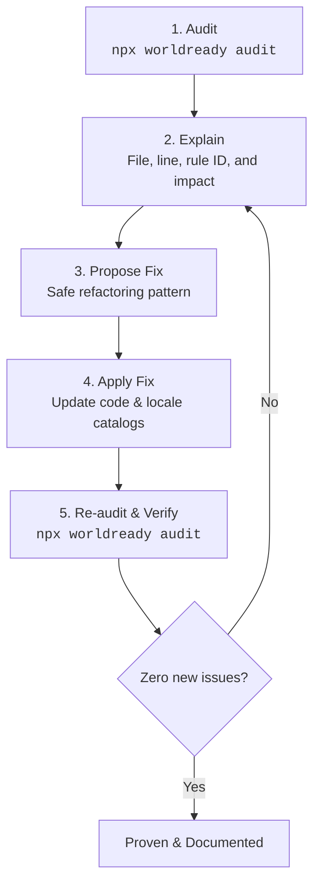

# WorldReady: Internationalisation Engineering Skill

> **"Find it. Fix it. Prove it."**
>
> WorldReady is a framework-independent internationalisation (i18n) and bidirectional (RTL) audit engine. It provides deterministic AST-level detection of internationalisation defects, safe code transformations, and executable verification.

---

## 1. When to Use This Skill

Activate this skill whenever:
- Auditing a repository for internationalisation (i18n), localization (l10n), or bidirectional layout (RTL) readiness.
- Resolving hardcoded user-facing strings, dynamic string concatenations, or missing translation keys.
- Fixing placeholder mismatches between source and target locale messages.
- Adapting styles for right-to-left (RTL) languages (Arabic, Hebrew, Persian, Urdu) using CSS logical properties.
- Investigating date, number, or currency formatting flaws.
- Running pseudo-localization (`en-XA`, `ar-XB`) to detect text truncation, layout clipping, and unextracted strings.
- Preparing CI pull-request checks or generating SARIF/JSON/Markdown audit reports.

---

## 2. Core Operational Rules for AI Coding Agents

When acting as an AI coding agent (Claude Code, Cursor, Codex, Gemini CLI, Copilot):

1. **Deterministic Proof Over Unverified Claims**:
   - Never claim an i18n or RTL issue is fixed without executing an audit to verify.
   - Never invent or assume translations without developer confirmation or existing catalog keys.
   - Distinguish strictly between **Verified Fixes** (tested via `npx worldready audit`) and **Proposed Advice**.

2. **AST-Driven Precision**:
   - Never rely on naive regex search-and-replace for source code remediation.
   - Respect component AST structures, JSX interpolation rules, and framework patterns.

3. **Safe Refactoring**:
   - Preserve existing architecture (e.g., `next-intl`, `react-i18next`, FormatJS, Vue I18n).
   - When extracting strings, register the key in the source locale catalog *and* create corresponding entries or stubs in target locale catalogs.
   - When converting CSS, use CSS Logical Properties (`margin-inline-start` instead of `margin-left`).

---

## 3. The 5-Step Fix-and-Verify Loop

Every remediation task MUST follow this disciplined 5-step loop:



### Step 1: Audit
Execute the deterministic scanner to discover all active defects:
```bash
npx worldready audit
```
For targeted analysis:
```bash
npx worldready audit --locales ar,fr --format json
```

### Step 2: Explain
Before touching any files, summarize the findings for each location:
- **File & Line**: Exact file path and line number.
- **Rule ID**: The specific rule triggered (e.g. `WRD001`, `WRD103`).
- **Severity & Confidence**: E.g. `error` (0.95 confidence).
- **Technical Impact**: Why this breaks i18n (e.g., sentence assembly breaks grammatical word order in German; missing `margin-inline-start` breaks mirroring in Arabic).

### Step 3: Propose Safe Fix
Draft the exact code modification and translation dictionary updates before modifying the file. Confirm key naming conventions (e.g. `feature.component.action_label` or flat keys).

### Step 4: Apply Fix
Apply minimal, targeted modifications:
- Wrap strings with translation hooks/functions (e.g., `t('button.submit')`).
- Add translation key to source catalog (e.g., `locales/en/common.json`).
- Add corresponding entries to all target catalogs (e.g., `locales/fr/common.json`, `locales/ar/common.json`).
- Convert physical CSS properties to logical equivalents.

### Step 5: Re-Audit and Verify
Re-run the audit command:
```bash
npx worldready audit
```
- Confirm the original finding is resolved.
- Verify that no new errors or warnings (such as `WRD101` or `WRD103`) were introduced.
- Report the before-and-after finding counts to the user.

---

## 4. Rule Catalogue Summary

WorldReady enforces standard, stable rule identifiers:

| Rule ID | Name | Category | Default Severity | Description |
| :--- | :--- | :--- | :--- | :--- |
| **WRD001** | Hard-coded UI text | `source-text` | `warning` | Identifies untranslated user-facing text in JSX/TSX tags, HTML elements, and UI attributes (`title`, `placeholder`, `aria-label`, `alt`). Excludes code identifiers, URLs, imports, and logs. |
| **WRD002** | Dynamic text concatenation | `source-text` | `warning` | Detects string concatenation (`"Hello " + name`) and template literals mixing text with variables in UI render blocks. These break grammatical word order in target languages. |
| **WRD101** | Missing translation key | `translations` | `error` | Identifies translation keys present in source locale (e.g. `en`) but absent from target locales (e.g. `fr`, `ar`). Causes missing UI strings at runtime. |
| **WRD102** | Unused translation key | `translations` | `suggestion` | Detects translation keys defined in locale dictionaries that are never referenced in source code. Cleans up stale translation debt. |
| **WRD103** | Placeholder mismatch | `translations` | `error` | Flags variable placeholders (e.g. `{name}`, `{{count}}`, `%s`) in source strings that are missing, misspelled, or mismatched in target translations. Prevents runtime interpolation crashes. |
| **WRD301** | RTL declaration issue | `rtl` | `warning` | Checks for missing document-level `dir` attributes (`dir="rtl"`) or hardcoded CSS `direction: ltr` when RTL locales (Arabic, Hebrew, Persian, Urdu) are configured. |
| **WRD302** | Physical CSS properties | `rtl` | `warning` | Detects physical CSS properties (`margin-left`, `padding-right`, `left`, `right`, `text-align: left`) that prevent automatic layout mirroring in RTL locales. Recommends CSS Logical Properties. |
| **WRD401** | Locale-insensitive formatting | `locale-formatting` | `warning` | Identifies naive formatting methods (e.g. `.toLocaleDateString()` without locale parameters, `$${amount}`, or `.toFixed(2)` for currency) that ignore locale number and currency conventions. |

---

## 5. CLI Command Reference

Execute WorldReady CLI commands via `npx worldready <command>` or `pnpm worldready <command>`.

### `audit`
Runs deterministic AST and translation file scans:
```bash
# Basic scan using worldready.config.json
npx worldready audit

# Override target locales
npx worldready audit --locales ar,fr,de

# Output as SARIF for CI integration
npx worldready audit --format sarif -o report.sarif

# Output as JSON or Markdown
npx worldready audit --format markdown -o audit-report.md
npx worldready audit --format json
```

### `init`
Inspects repository structure, auto-detects framework (Next.js, React, Vue, HTML), discovers locale files, and generates `worldready.config.json`:
```bash
npx worldready init
```

### `baseline`
Suppresses existing technical debt so teams can enforce zero-regression on new pull requests:
```bash
# Save existing findings into baseline
npx worldready audit --save-baseline .worldready-baseline.json

# Run audit filtering out findings present in baseline
npx worldready audit --baseline .worldready-baseline.json
```

### `test` (Pseudo-Localization)
Generates pseudo-locales to test UI resilience before translations are completed:
```bash
# Test European accented expansion (detects clipping and layout overflow)
npx worldready test --locale en-XA

# Test simulated Right-to-Left (detects alignment and direction flaws)
npx worldready test --locale ar-XB
```

### `ci`
Continuous Integration runner. Runs audit with SARIF output and fails with non-zero exit code if any `error` level findings are present:
```bash
npx worldready ci
```

### `rules`
Lists all available rules, their descriptions, severity, and categories:
```bash
npx worldready rules
```

### `doctor`
Performs diagnostic checks on project configuration, translation catalogs, and locale directory integrity:
```bash
npx worldready doctor
```

---

## 6. Detailed Technical References

Before implementing remediation, consult the dedicated reference manuals:

- **Audit Methodology & Precision**: [references/audit-methodology.md](file:///c:/Users/Richb/Downloads/hi/worldready/skills/worldready/references/audit-methodology.md)
  *AST traversal algorithms, confidence scoring, false-positive suppression, and parser boundaries.*
- **RTL & Bidirectional Engineering**: [references/rtl-engineering.md](file:///c:/Users/Richb/Downloads/hi/worldready/skills/worldready/references/rtl-engineering.md)
  *Script vs language direction, CSS Logical Properties, `<bdi>` isolation, and W3C bidirectional guidelines.*
- **Locale Engineering & CLDR Standards**: [references/locale-engineering.md](file:///c:/Users/Richb/Downloads/hi/worldready/skills/worldready/references/locale-engineering.md)
  *Intl formatters, Unicode CLDR plural rules, currency conventions, and pseudo-localization (`en-XA`, `ar-XB`).*
- **Remediation Patterns**: [references/remediation.md](file:///c:/Users/Richb/Downloads/hi/worldready/skills/worldready/references/remediation.md)
  *Safe code transformations for React/Next.js, string extraction patterns, CSS logical migrations, and placeholder alignment.*

---

## 7. Multi-Agent Cross-Platform Guidance

WorldReady is designed as a single canonical skill supporting all major coding agents:

### Claude Code
- Discovery directory: `.claude/skills/worldready/` or global skill cache.
- Execution model: Claude Code will run terminal commands (`npx worldready audit`), read output, and execute the 5-step loop automatically.

### Cursor
- Discovery directory: `.agents/skills/worldready/` or `.cursor/rules/`.
- Prompting pattern: Point Cursor agent to `@worldready` to trigger project-wide scans and apply patch proposals.

### GitHub Copilot
- Discovery directory: `.github/skills/worldready/`.
- Interaction: Request workspace-wide audit via Copilot terminal interaction.

### Gemini CLI / Antigravity
- Discovery directory: `.gemini/antigravity/skills/worldready/` or project `skills/worldready/`.
- Native execution via tool calls with automated audit and verification loops.

---

## 8. Summary of Verifiable Output

When reporting to users or PR reviews, format findings with structured clarity:

```markdown
### WorldReady Audit Summary
- **Files Scanned**: 42
- **Errors**: 0 (was 3 — all verified resolved)
- **Warnings**: 1 (baseline suppressed)
- **Suggestions**: 2

#### Verified Fixes:
1. `src/components/Header.tsx:14` — Extracted hardcoded "Welcome back" to `header.welcome_back` (WRD001 resolved).
2. `public/locales/fr/common.json:8` — Added missing placeholder `{count}` for key `cart.items` (WRD103 resolved).
3. `src/styles/sidebar.css:22` — Migrated `margin-left: 16px` to `margin-inline-start: 16px` (WRD302 resolved).
```
